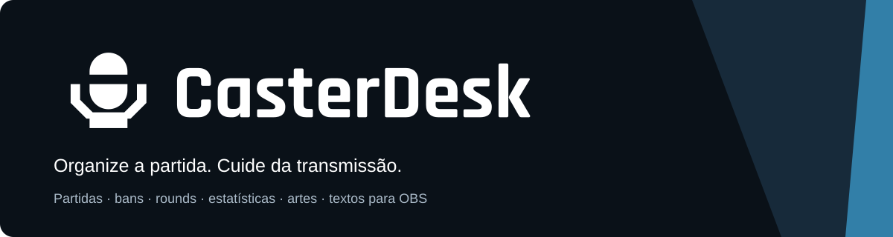
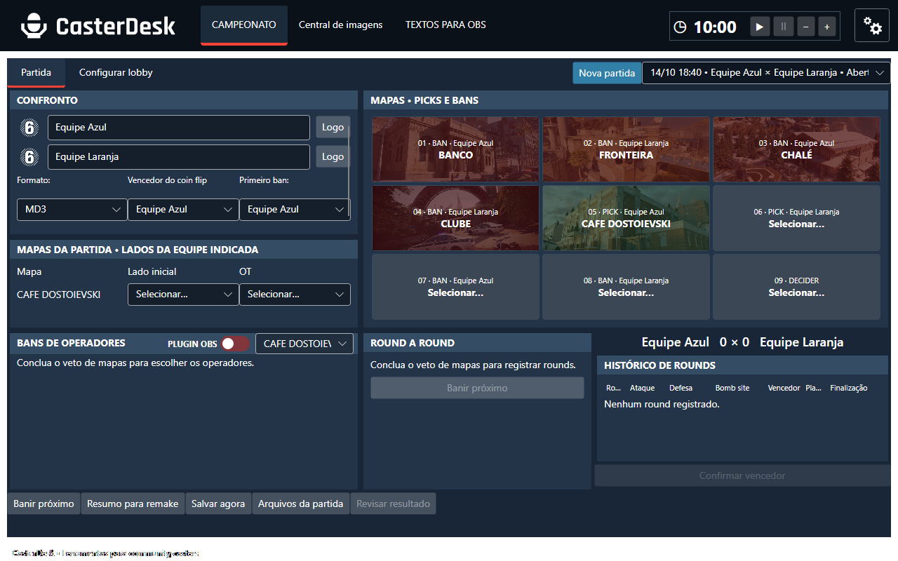
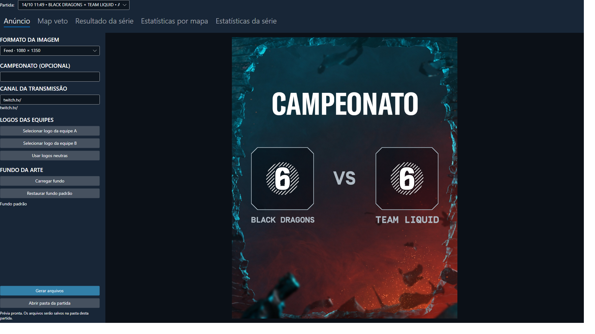
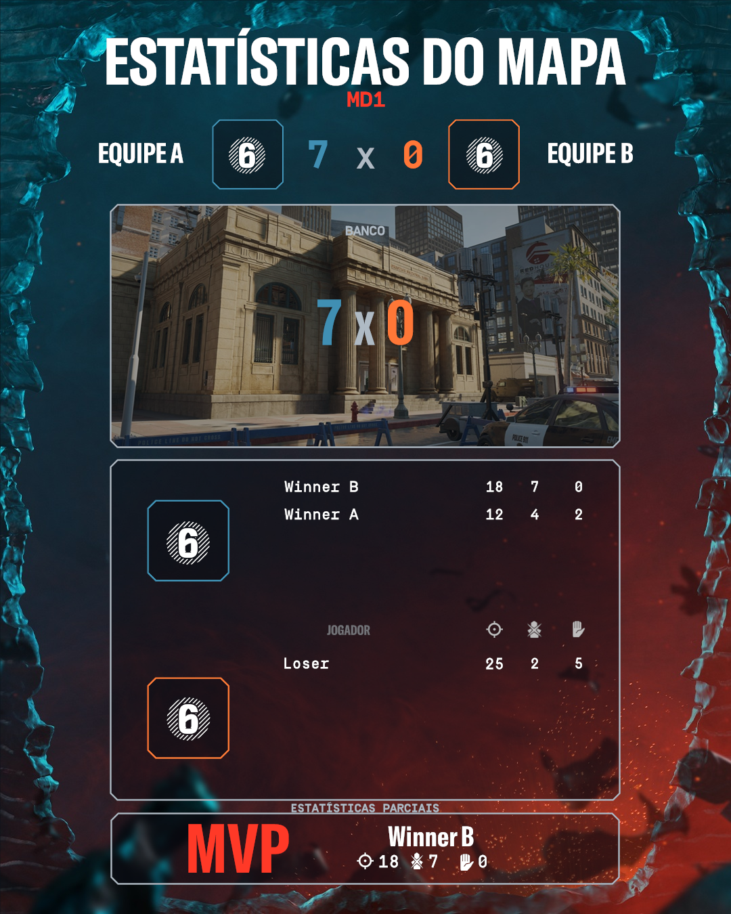
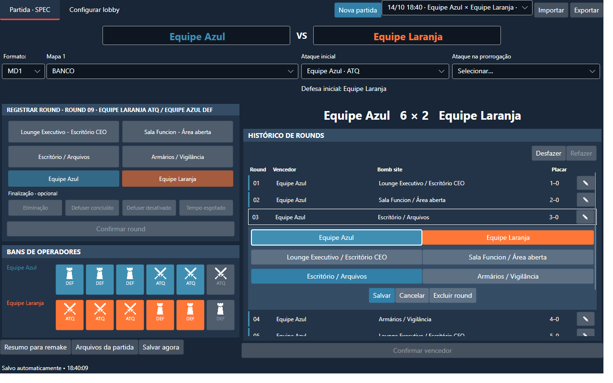
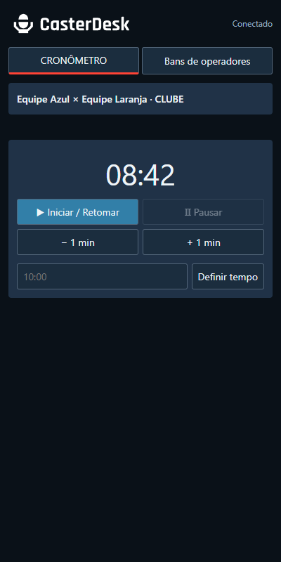
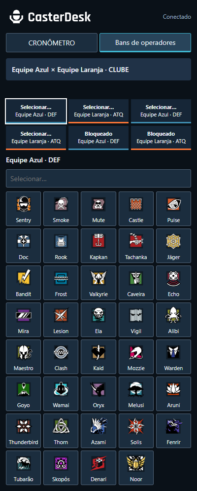

<p align="center">
  
  
  
  
</p>

<p align="center">
  <a href="https://github.com/moska1m/CasterDesk/releases">Downloads e versões</a> ·
  <a href="#o-que-você-pode-fazer">Funcionalidades</a> ·
  <a href="docs/OBS.md">Conexão com OBS</a> ·
  <a href="CHANGELOG.md">Novidades</a> ·
  <a href="CONTRIBUTING.md">Contribuir</a>
</p>

**CasterDesk é uma ferramenta para community casters de Rainbow Six Siege:** organiza a partida, acompanha o veto e os rounds, prepara informações para a transmissão e gera artes para divulgação e resultados.

## Por que o CasterDesk existe

O projeto nasceu da rotina de transmitir campeonatos da comunidade: controlar o tempo, atualizar nomes, acompanhar bans e placares e preparar imagens enquanto a partida acontece. A intenção é reunir essas tarefas em um programa que ajude o caster a dedicar mais atenção à transmissão.

Começou com cronômetro e arquivos de texto para OBS. Evoluiu com o uso e o feedback de casters: partidas completas, registro rápido de rounds, bans de operadores, histórico, estatísticas por print e uma Central de imagens. As composições de divulgação e resultados foram desenvolvidas com a colaboração de JG. A identidade aprovada combina um microfone monocromático com o nome **CasterDesk**, unido, em Rajdhani Bold; a interface mantém Segoe UI para leitura.

## O que você pode fazer

| Área | O que oferece |
|---|---|
| **Partidas** | MD1, MD3 e MD5; registro do vencedor externo do coin flip, veto de nove mapas, lados e prorrogação. |
| **SPEC** | Tela alternativa no menu, mesmos dados, escolha direta de mapas, edição inline de rounds, exclusão confirmada e desfazer/refazer. |
| **Bans** | Ícones na ordem do jogo, Sem banimento repetível no final, etapas DEF → ATQ, equipe responsável e revisão protegida. |
| **Rounds** | Registro rápido de bombsite, vencedor e finalização; histórico com placar, ataque/defesa e cores fixas. |
| **Estatísticas** | Print por arquivo ou Ctrl+V, leitura de nomes/E/M/A, revisão lado a lado e correção manual; suporte a remake e dados incompletos. |
| **Central de imagens** | Anúncio, map veto e estatísticas por mapa/série; logos opcionais, logo neutra, fundos e cores por categoria. |
| **OBS** | Cronômetro e nomes/perfis do casting em TXT; map veto transparente em caminho fixo. Plugin opcional beta com painel nativo de rounds/bans/timer e conexão automática. |
| **Arquivos e backup** | Pasta por partida com JSON, imagens e recursos; importação/exportação, recuperação de salvamento e backup/restauração. |

Os dados permanecem no computador. O CasterDesk registra as decisões do usuário; não lê partidas ao vivo nem controla o jogo.

## Conheça a interface



*Prévia renderizada pelos controles do programa com dados de demonstração. O timer permanece acessível na barra fixa; registro e histórico ficam à direita dos bans.*

<details>
<summary><strong>Central de imagens e exemplo de estatísticas</strong></summary>



<p align="center"></p>

As artes preservam as proporções das bases fornecidas. Mapas não jogados ficam em preto e branco; ausência de estatísticas não vira zero. O MVP automático considera eliminações da equipe vencedora, com seleção manual disponível.

</details>

## Começar a usar

**Atualizando de uma versão anterior?** Feche CasterDesk e OBS. No instalador 1.0.7, marque **Instalar o painel CasterDesk no OBS** para atualizar também o plugin; atualizar somente o app mantém a DLL anterior. Veja o [resumo das novidades desde a 1.0.1](RELEASE-NOTES.md).

1. Use o instalador entregue com a atualização local ou escolha uma versão registrada em [Releases](https://github.com/moska1m/CasterDesk/releases). A versão **1.0.7** está preparada para Windows x64.
2. Confira o nome/versão do instalador e o SHA-256 disponibilizado junto dele.
3. Instale e abra **CasterDesk**. O pacote inclui o runtime .NET; não é necessário instalar o SDK para usar.
4. Crie uma partida, informe as equipes e registre o coin flip feito fora do programa. Complete o veto, defina os lados e inicie os bans por clique.
5. Registre os rounds, confirme o resultado de cada mapa e confira os prints antes de exportar estatísticas.

Na engrenagem, selecione Português (Brasil), English ou Español. O idioma é aplicado na próxima abertura. Nomes personalizados e IDs internos são preservados ao importar partidas entre idiomas.

**Validação:** os testes automatizados e prévias em memória foram executados; o instalador não tem assinatura digital. Instalação em outros PCs, escalas/monitores e OCR real ainda precisam de validação. Evidências e limites: [PROGRESSO.md](PROGRESSO.md).

## Modo SPEC



Ative pela engrenagem. Mesma partida, apresentação compacta, mapas e lados no topo. Finalização opcional; confirme com bombsite e vencedor. O timer do cabeçalho fica oculto nesse modo.

## Usar com OBS

Na versão 1.0.7, configure fontes de texto para ler os TXT do CasterDesk. Para o map veto, configure uma fonte de imagem com o caminho fixo copiado pelo programa: a próxima geração substitui esse PNG, preservando cópias na pasta da partida.

O painel registra/corrige rounds, seleciona mapas de séries e controla o mesmo timer e os bans sem alternar de janela. Marque a instalação opcional do plugin OBS no instalador para conexão automática. As instruções e limites estão em [docs/OBS.md](docs/OBS.md). Stream Deck fica para uma etapa futura.

<details>
<summary><strong>Painel de navegador anterior (beta.0.9)</strong></summary>

 

Prévias em navegador sem janela, com dados de demonstração. API real testada separadamente; navegador integrado do OBS ainda não validado.

</details>

## Seus arquivos

Os dados ficam em **Documentos/CasterDesk**, respeitando a localização de Documentos no Windows: uma pasta por partida com JSON, artes, prints e recursos, além de pastas separadas para textos, configurações e backups. Os caminhos TXT podem ser personalizados.

Importar só um JSON não transporta todos os recursos: use pacotes/backup para levar imagens e configurações. A desinstalação da beta atual preserva os dados. Detalhes de compatibilidade: [formato JSON](MATCH-JSON-FORMAT.md).

## Evolução do projeto

| Linha | Evolução |
|---|---|
| **0.1** | Cronômetro, casting e primeiras ferramentas para a transmissão. |
| **0.2** | Fluxo de campeonato, registro rápido, bans e exportação de imagens. |
| **0.3 até beta.0.4** | Estabilização de comandos, persistência, importação, backup e adaptação anterior da interface. |
| **0.3 beta.0.5–0.6** | Interface renovada, publicação autossuficiente e ajustes de partida/lobby. |
| **0.3 beta.0.7** | Aplicação da marca aprovada. |
| **0.3 beta.0.13** | Guia REMAKE por mapa, cards de ícones por equipe e cabeçalho/status ajustados no OBS. |
| **0.3 beta.0.12** | OBS com rounds por botões, histórico e bans juntos; timer completo e ajustes de layout/menu. |
| **0.3 beta.0.11** | Rounds e mapas da série no OBS, bans durante toda a partida e modo explícito sem popups. |
| **0.3 beta.0.10** | Plugin opcional OBS com descoberta automática. |
| **0.3 beta.0.9** | Painel local para timer/bans no OBS, ativação explícita e proteção de comandos. |
| **0.3 beta.0.8** | Timer fixo, layout compacto, ordem de bans corrigida e melhorias no histórico/MVP. |

[Changelog](CHANGELOG.md) · [Histórico dos arquivos recuperados](RELEASE-HISTORY.md) · [Releases](https://github.com/moska1m/CasterDesk/releases)

Algumas betas antigas têm instaladores preservados, mas não um snapshot exato separado dos fontes. Isso é identificado nos arquivos históricos; não foram inventados commits retroativos.

## Desenvolvimento

Aplicativo Windows em C# e .NET 10, com comandos e serviços compartilhados. Renderização e OCR usam serviços Windows. As entregas priorizam o instalador local para teste; atualizações no GitHub são feitas quando necessárias ao processo ou solicitadas.

```powershell
dotnet restore source-avalonia/CasterDesk.Avalonia.csproj
dotnet build source-avalonia/CasterDesk.Avalonia.csproj -c Release
./scripts/Test-Core.ps1
./scripts/Test-Avalonia.ps1
```

Os testes usam uma pasta isolada e o backend Headless; não abrem o programa na área de trabalho. Para empacotar, use `scripts/Package-Avalonia.ps1 -Iscc <ISCC-x64.exe> -Dotnet <dotnet.exe> -PluginPackage <pasta-do-plugin-compilado>`. Os scripts aceitam configuração explícita de restore offline.

Documentação: [formato JSON](MATCH-JSON-FORMAT.md), [validação](PROGRESSO.md), [contribuição](CONTRIBUTING.md).

## Próximas etapas

- [x] Painel local beta: timer e bans sincronizados com o CasterDesk.
- [ ] Validar o carregamento do plugin, encaixe no OBS e instalação/UAC.
- [ ] Validação nativa em outros PCs e escalas de tela.
- [ ] Revisão regional dos termos em espanhol e inglês.
- [x] Instalador com identidade visual, aceite PT/EN/ES e abertura opcional ao terminar.
- [ ] Controle por Stream Deck.

## Condições de uso e marca

O instalador pede ciência dos [termos de uso](docs/TERMOS-PT.txt). Código próprio MIT e plugin GPL mantêm suas permissões; nome, marca, pacote apresentado como oficial e recursos de terceiros são distintos. Use as artes nos limites das autorizações do evento/canal e dos titulares. O aceite não concede autorização da Ubisoft.

## Créditos e licenças

Projeto conduzido por **moska1m**, com feedback de community casters e colaboração visual de **JG**. Código próprio sob [MIT](LICENSE). A tipografia Rajdhani da marca usa SIL OFL; fontes e componentes mantêm seus avisos.

Imagens, operadores, marcas de Rainbow Six Siege e outros recursos de terceiros **não estão cobertos pela licença MIT do código**. Consulte [THIRD-PARTY-NOTICES.md](THIRD-PARTY-NOTICES.md) para origens e situação dos recursos antes de distribuição ampla. O CasterDesk é independente e não representa produto oficial ou endosso da Ubisoft.
